##### Department of Electrical & Electronic Engineering
##### Imperial College London

#### **ELEC50001 Circuits & Systems**

### **Lab 3 - Introduction to DE10-Lite & Quartus Prime Lite**
##### *Peter Cheung, v3.4 - 26 October 2026*

#### **Objectives**

By the end of this experiment, you should have achieved:

* Launching Quartus Prime Lite v20.1 on one of the Lab’s PCs;
* Create a directory structure for this and subsequent Labs;
* Create a new project in Quartus and complete a basic 7-segment LED display decoder design using Quartus and SystemVerilog from start to finish;
* Program the Max 10 FPGA chip on the DE10-Lite board with your design;
* Explore and test your decoder design;
* Analyse the propagation delay of the decoder circuit.

#### **Running Quartus Prime Lite**

Like the Labs in the first half of the Autumn term, you are expected to conduct the remaining Lab Sessions in Level 1 Lab. You will be using Intel/Altera software known as **Quartus Prime Lite** which are already installed locally on all the Lab PCs.

For those who wish to install Quartus Prime Lite on their own personal laptop, **do so at your own “risk”**.  Beware that this may take effort and time on your part.  

If you do want to install Quartus on your own machine, you will need to have at least 30GB free disk space and at least 8GB of RAM (preferably 16GB of RAM) on your laptop.

#### **Intel processor based PC running Windows OS**

This method is the easiest to have Quartus Prime Lite installed. Quartus is one of the software available on Software Hub.  Search for **“Quartus”** among all the Software Hub packages. You will find two are available. Select the package on the RIGHT.

Click “Launch” and Quartus Prime Lite v20.1 will be downloaded and onto your PC. Run Quartus at least once while you are on College wifi (so that the license is verified).  Thereafter, Quartus will be cached locally on your PC and the license will be valid for another 30 days.  The software package is large – you need to download a few gigabytes! Therefore, you are strongly advised to do this while on campus for the first time.  Finally, you need to install the USB Blaster driver which you can download from the course webpage.

#### **Apple MacBook with Intel processor**

If you are using an Intel Apple machine, it is possible to run a virtual machine (e.g. Virtual Box), the Ubuntu (Linux) Operating System, and the Linux version of Quartus Prime Lite.  Do this ONLY if you are familiar with VM and Linux operating systems.  Also note that Quartus Prime Lite was designed to run on Windows or Linux operating systems.  There may be issues running Quartus on MacBooks under VM.  If you have an Intel MacBook and want to use Quartus on this, please talk to Peter Cheung to obtain further instructions.

#### **Apple MacBook with Mx processor**
You cannot run Quartus on MacBook with Apple silicon M1 or M2.  You can only use the Windows PCs in the Lab.  There are a few Laptops that you may be able to borrow overnight with your ID card from Level 1 stores.

>Note that the FPGA chip is **10M50DAF484C7G**.  Make sure that you specify THIS DEVICE exactly in your design.

#### **The DE10-Lite FPGA Board**

Borrow a DE10-Lite FPGA board from level 1 stores with your ID card.  You can keep this until the end of the Autumn term. Connect the DE10 board to your laptop using the USB cable provided.  You should see the board LED displays cycling through all digits, showing that the board is working properly.  The diagram below shows the features provided on this board. 

<p align="center"> 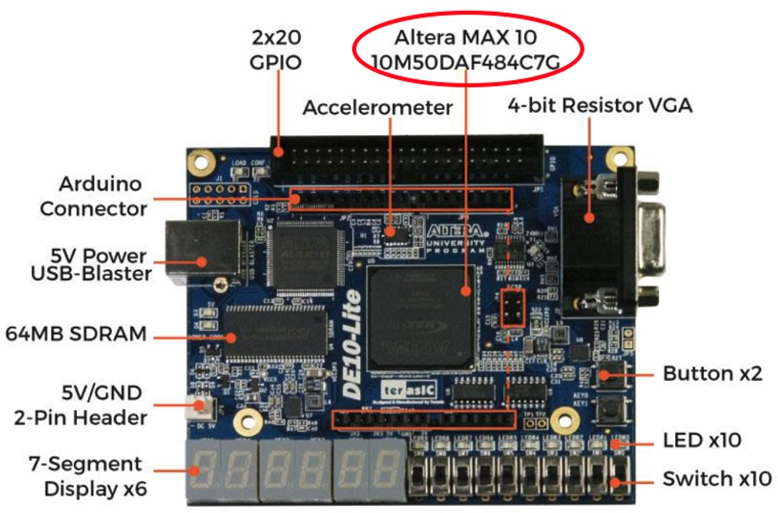 </p>

---
#### **Task 0: Preparation**
---

In task 1, you will use four slide switches on the right (SW3 to SW0) on the DE10 board as inputs and display the 4-bit binary number as a hexadecimal digit on the right-most 7-segment display (HEX0).   In task 0, you will check that everything is working properly. 

**Step 1:**  Creating a good directory structure
Before you start carrying out any design for this Lab, it would be very helpful if you first create a directory structure for Lab 3 to 6 on your “h: drive”.  Shown on the right is a possible directory structure that you may choose to create.  Each folder is empty for now, but as you progress through the four Lab Sessions, you will be creating each design in each of the folders. 

<p align="center"> 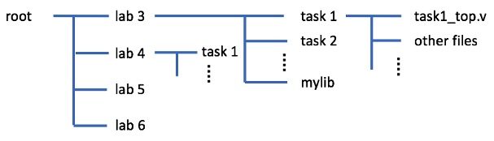 </p>

**Step 2:**  See what you are aiming for
Go to the course webpage and download a copy of the solution for Exercise 1: **_“lab3task1_sol.sof”_** to your folder for Lab3 (or wherever that is).  Make sure that your DE10 board is plugged in and running.

<p align="center"> 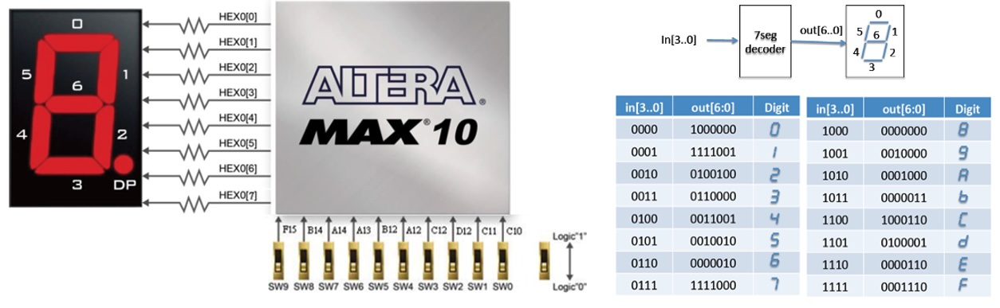 </p>

#### Step 3:  Setting up programming hardware
Run Quartus software on your lab PC.  Click command: **Tools > Programmer**.  In the popup window, click: **Hardware Setup …**.  You should see something like the diagram on the right.  Then select: **USB Blaster**. This is to tell Quartus software that you are using the DE10 interface to program (or blast) the FPGA.  

If you do not see USB-Blaster under Hardware Setup although the DE10-Lite is plugged in properly, it is most likely that the Device Driver had not been installed or loaded properly. In which case, ask one of the GTAs for help.

#### Step 4: Blasting the FPGA

Next click the **AddFile** button. Navigate to the folder containing the **_lab3task1_sol.sof_** file.  Select this.  You should see a display like this:

<p align="center"> 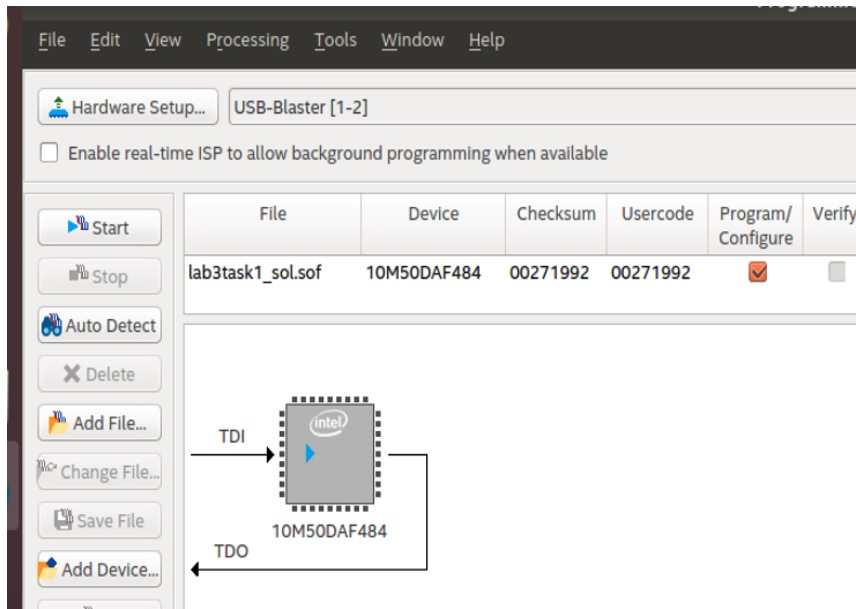 </p>

Note that the device indicated here is the one on the DE10 board: **10M50DAF484**. Click the **Start** button.

The **_lab3task1_sol.sof_** file contains the solution to Task 1.  It has the **bit-stream** to configure (or programme/blast) the FPGA Max10 chip. Once the bit-stream is successfully sent to the FPGA chip, the task1 design will take over the function of the chip.  You should be able to change the least significant four switches and see a hexadecimal number displayed on rightmost 7-segment display. Now you are ready to create this design from scratch.

The remaining part of Lab 3 will be teaching you how to create YOUR OWN version of this design and blast it onto the FPGA.

---
### **Task 1: The Design Flow – 7 Segment LED Display**
---

#### Step 1: Create the project “task1”

* Create in your home directory the folder **_E2_CAS/lab3/task1_**.  
* Click **file > New Project Wizard**, complete the form. Use **task1** as the project name and **task1_top** as top-level design name.  
* Click **Finish**.

<p align="center"> 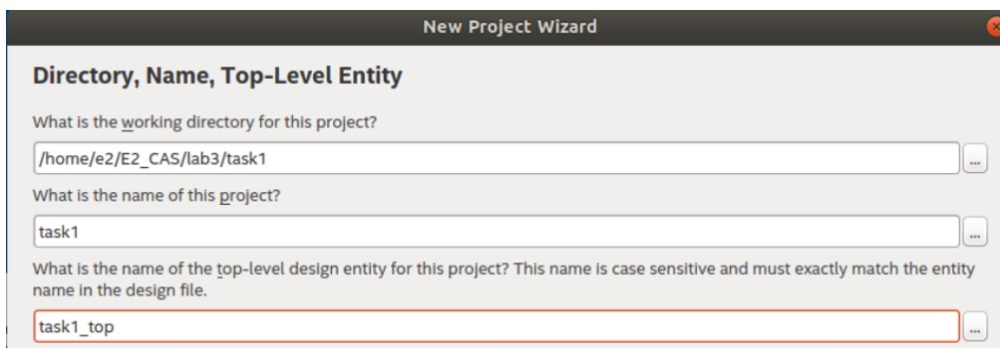 </p>

#### Step 2: Device Assignment

Click **Assignments > Device**, and select the Max 10 chip used in DE10, which is:  **10M50DAF484C7G**.  

>**Interpretation of the device code**: **10M** is Max10 family. **50** is the size of the device of around 50,000 logic elements.  **484** is the number of pins.  **C7** is the speed grade.

#### Step 3: Creating the SystemVerilog specification

* In Quartus, create a design file for the decoder module in SystemVerilog HDL as hexto7seg.sv using: **File >  New ...**. and select SystemVerilog HDL from the list.

* Type the source file as shown here. Make sure that you pay attention to the syntax of SystemVerilog.  Save your file.

<p align="center"> 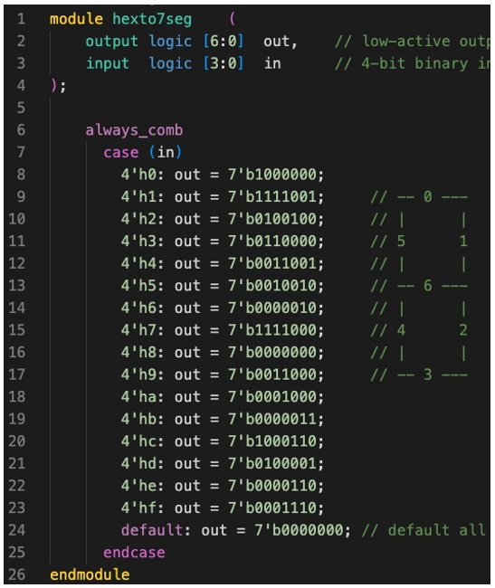 </p>

* At this stage, you check the syntax of your code by clicking:  **Process > Analyze current file**.  You should get into a habit of ALWAYS perform this step to make sure that the new SystemVerilog module you created is error free.  It will save you a lot of time later.

* Click:  **Project > Add Current file to Project** to include this module in your design.

#### Step 4:  Create Top-Level Specification in SystemVerilog

* We need to create a top-level (at chip level) design that make sure of the decoder module. Create the file **_“task1_top.sv”_** as shown below.  

<p align="center"> 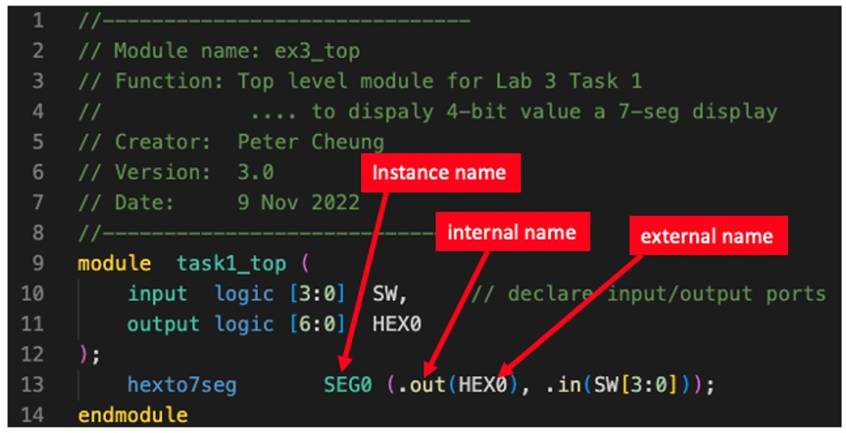 </p>

* Specify that this is file as our **top-level design** with:  
```
Project > Set as Top-level Entity ….
```
* Verify that everything works properly with:  
```
Process > Start > Start analysis & elaboration
``` 
Make sure that there is **no error**.  

**Warnings** often capture potential errors.  However, the Quartus system generates many warnings, and nearly all of which are not important.  Once you have gain confidence in the system, you may start ignoring the warning, but never ignore any error.

>You will save a lot of time if you ALWAYS use these two steps: analyze, and analysis & elaboration, and ensure that ALL errors are dealt with (and warning understood).

Note:  Every time you create a new entity or module as part of your design, you must include the file in the project.  Click:
```
Project  >  Add Current Files to Project …
```
Step 5: Pin assignment – the hard way

You need to associate your design with the physical pins of the Max 10 FPGA on the DE10 board.  We will now only assign two of 11 pins used in our design.

* Click Assignment > Pin Planner   and a new window with the chip package diagram. You should also see the top-level input/output ports shown as a list.


<p align="center"> 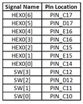 </p>

<p align="center"> 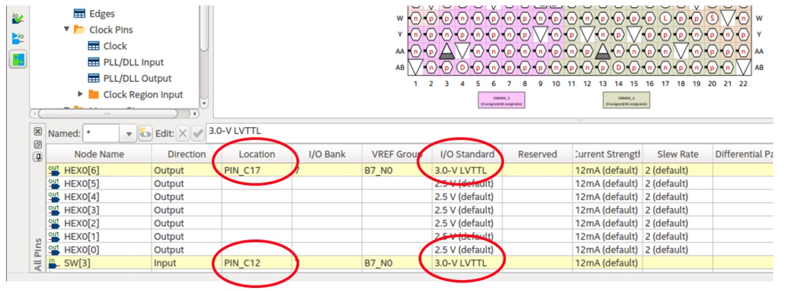 </p>

* Click on the field shown and select the appropriate values for Location and I/O standard.
* Close the pin assignment window and click: **File > open…**/  Enter *.* in the file name field and select: **_task1.qsf_** (qsf = **Q**uartus **S**etting **F**ile).  Examine its contents.  You should see the effect of the manual pin assignment step as highlighted in RED.
* The first line defines the physical pin location of **HEX0[6]**  is **PIN_C17**.
* The second line defines the voltage standard used is 3.0V LVTTL.

<p align="center"> 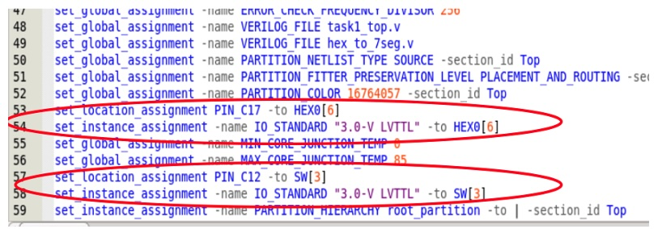 </p>

#### Step 6: Pin Assignment – the easy way

* Manual pin assignment is tedious and prone to errors.  A much better way to perform pin assignment is to **insert a text file** with the necessary information directly into the **.qsf** file.

* Delete the four lines highlight above which was created through the manual pin assignment in Step 9.  
* Download from the course webpage: **_pin_assignment.txt_** to the task1 folder.
* Click:  **Edit > Insert File …**   and insert **_pin_assignment.txt_** at the end of the file.

ALL the pins used on the DE10 are assigned here. However, unused pins are ignored.

#### Step 7: Compile the design & Programming the FPGA

* Click **Process > Start Compilation**.  This will perform all the steps of compilation, placement, routing, fitting etc. and produce a bit-stream file (.sof) ready to blast onto the FPGA.
* Examine the Compilation Report and you should see a Flow Summary similar to the one shown here.  

<p align="center"> 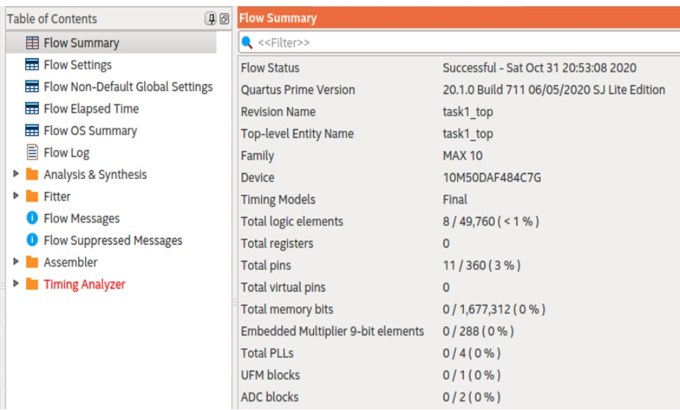 </p>

* This correctly shows that the design used 8 logic elements (out of nearly 50,000) and 11 pins.
* Programme the DE10 with YOUR design with the file: **_task1_top.sof_**. (See Task 0 if you have forgotten how to do this.)   Test you design.

>**Congratulations! You have now completed your design from beginning to the end.**

#### **Put verified modules in _mylib_ folder**

For the rest of this module, you will design and verify various SystemVerilog modules which you will reuse.  You should copy h**_exto7seg.sv_** (and others in the future) to the “**mylib**” folder and include them in your new design as necessary.

>**Note:**  When you perform a compilation, there may be a popup window informing you that some “Chain_x.cdf” file has been modified, and ask if you wish to save it. Just click NO.

---
### **Task 2: Explore Netlist Viewer and Timing Analyzer**
---

#### **Step 1:   Viewing the design**

Quartus Prime provides a graphical view of the synthesized design. Exploring this provides you with some insight into how the SystemVerilog HDL code is turned into actual FPGA hardware.

* Click:  **Tools > Netlist Views > RTL Viewer**

This should appear on your screen:
<p align="center"> 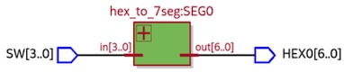 </p>

* Push down into this block (clicking it) and investigate what is being displayed and how it relates to the decode logic.

RTL Viewer only shows the abstract Boolean description of the design, not the physical implementation on the FPGA.

* Click  **Tools > Netlist Views > Technology Map Viewer (post mapping)**

>Explain what you find and link this back to the Compilation Report.

#### **Step 2:  Timing Analyzer**

* Click  **Tools > Timing Analyzer**

A Timing Analyzer window will appear.  
Now click **Report datasheet**.  The Timing Analyzer tool will provide datasheet type table showing the propagation delays of all the paths in your design

Make a copy of the results in your logbook. Consider these worst-case delays at different temperature and explain what you found.

<p align="center"> 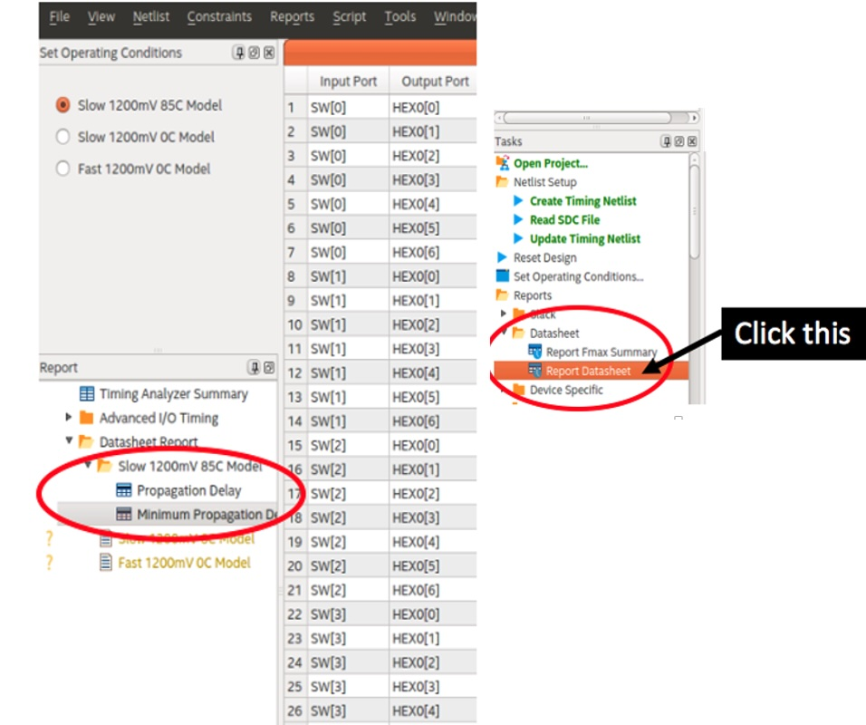 </p>

#### **Step 3:  Test yourself**

Create your own design in task2 folder (top-level file is **_task2_top.sv_**) to display all 10-bit sliding switches as hexadecimal on three of the 7 segment LED displays.  